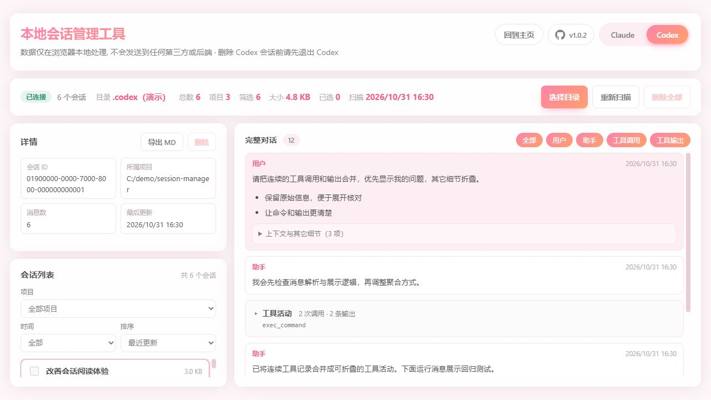

# 本地会话管理工具

在浏览器里浏览、筛选、导出和清理 **Claude Code / Codex** 的本地历史会话。无需安装、无需构建、无需后端，会话数据仅在本地处理，不上传到服务器。



*预览使用虚构演示会话，不含真实用户数据。*

## 在线使用

用 Chrome / Edge 打开 [本地会话管理工具](https://www.kafuucoori.top/session/app.html)。

也可以下载完整仓库，直接用 Chrome / Edge 打开 `app.html`。请保留同目录中的脚本和样式文件。

## 功能

- **浏览和筛选**：切换 Claude / Codex，按项目、时间筛选，按最近更新、大小或标题排序，滚动分批加载。
- **突出用户问题**：连续的环境、页面和附件信息与问题合并，正文展示实际请求，其余内容统一折叠；支持标题、列表、行内代码和代码块。
- **聚合工具活动**：连续工具调用与输出合并为可展开的工具组，摘要显示调用 / 输出数量，明细保持原始顺序。
- **清楚展示工具内容**：突出工具名称、命令和工作目录，解开常见 JSON 输出包装、还原换行，展示退出码和耗时；长输出和原始内容可展开核对。
- **按类型查看与导出**：筛选用户、助手、工具调用、工具输出；导出当前会话为 Markdown，包含所有匹配内容，不限于已滚动显示的部分。
- **清理本地会话**：支持单个、选中和全部删除，同步清理已识别的会话关联文件与记录。
- **Codex 分支保护**：若保留分支仍依赖待删父会话，在写入前阻止删除，避免分支失去历史内容。

展示分组不改变原始消息顺序和类型。工具摘要可能截断，Markdown 导出不能替代原始数据备份；界面中可展开查看保留的完整工具文本。

## 使用方法

1. 用支持 File System Access API 的 Chrome / Edge 打开页面。
2. 选择 **Claude** 或 **Codex**，点击「选择目录」并授予读写权限。
3. 选择数据根目录：
   - Claude：包含 `projects/` 的 `.claude` 目录。
   - Codex：实际的 `CODEX_HOME`（通常为 `.codex`），需要根目录或 `sqlite/` 中存在 `state_<版本>.sqlite`。
4. 扫描后选择会话预览，使用项目、时间和对话类型筛选，或点击「导出 MD」。
5. 删除前完全退出对应客户端。**「删除全部」针对全量已扫描的可删除会话，不受当前项目 / 时间筛选限制。**

浏览器会分别记住 Claude / Codex 的目录选择起点，但仍可能要求重新授权。页面无法直接指定用户主目录。Firefox / Safari 暂不支持本工具依赖的目录选择方式。

## 数据范围

| 来源 | 读取与清理范围 |
|---|---|
| Claude | `projects/<项目>/<UUID>.jsonl`、项目索引和会话目录，以及根目录下会话关联的附件、检查点、任务、调试记录、旧副本和输入历史 |
| Codex | `sessions/`、`archived_sessions/`、会话 / 输入索引，以及根目录和 `sqlite/` 中已识别的状态、历史、侧边栏、快照、摘要和其它按线程关联的数据库记录 |

Claude 仅识别严格的 `<UUID>.jsonl` 为主会话，读取自定义标题，支持用户记录中承载的工具结果。项目共享 `memory/` 保留。

Codex 合并状态库、侧边栏目录、索引和转录；支持普通、归档及仅剩数据库 / 索引记录的会话，扫描依然需要状态库。数据库读取会合并 WAL 中已提交的事务，删除会处理扫描范围内已识别的保留版本；具有主机字段的桌面记录仅按本地主机清理。授权根目录和 `sqlite/` 以外的数据库不自动处理。

仅覆盖本地转录与关联数据；不删除 Claude Chat、云端 Code、Cowork 或账号内的云端副本。

## 删除与分支保护

**删除不可撤销，请先备份并完全退出客户端。**

Codex 分页分支可能通过 `history_base.thread_id` 引用父会话的历史前缀。删除前，工具检查普通和归档转录中的该字段及 `forked_from_id`：

- 保留的分支仍引用待删会话时，阻止整次删除并显示关联 ID。
- 可以保留父会话，或明确选择相关分支一起删除；多级分支同样检查。
- 无法读取转录或缺少有效元数据时，取消删除，避免漏掉依赖。

派生子线程会随父线程一并收集清理；普通分支不会仅因来源引用自动加入删除集合。当前没有分支独立化、完整父级历史重建或误删恢复能力。

数据库先在内存中修改，再写回文件；数据库写入或后续校验失败会尝试恢复快照。随后执行的索引和转录清理**没有跨文件事务保证**，操作失败也可能已有部分清理完成，请重新扫描。工具不提供可靠的客户端运行检测或并发文件锁。

共享记忆、无明确线程关联的日志、备份、浏览器缓存、临时附件及扫描范围之外的数据，不在全面清理范围内。内部数据库和转录格式可能变化，后续版本需要继续适配。

## 开发与验证

开发入口与关键约定见 [Guide-Dev.md](./Guide-Dev.md)。普通脚本共享全局作用域，加载顺序由 `app.html` 定义；不要只部署 HTML 而遗漏其它运行文件。

消息展示回归测试（需要 Node.js）：

```sh
node --test tests/conversation.test.cjs
```

测试使用合成消息，覆盖上下文折叠、工具解包、长内容保留、HTML 转义、连续记录聚合及筛选边界，不读写真实会话，也不覆盖数据库删除流程。

主要文件：`core.js`（状态与工具）、`storage.js`（目录访问）、`claude.js` / `codex.js`（解析）、`conversation.js`（展示）、`script.js`（交互与导出）、`delete.js` / `codex-sqlite.js`（清理）、`styles.css`（样式）。SQLite 运行库随仓库提供于 `sql-asm.js`。
