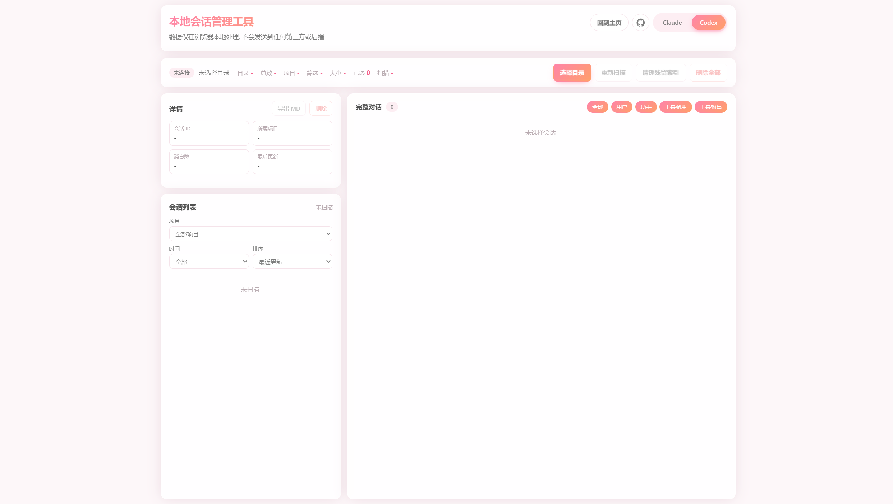

# 本地会话管理工具



一个本地会话管理工具，用于浏览、检索、导出和清理 **Claude Code** 与 **Codex** 的历史会话记录，所有数据仅在浏览器本地处理，**不会上传到任何服务器或第三方**。

## 在线使用

无需下载，直接打开即可使用（请用 Chrome / Edge）：

**https://www.kafuucoori.top/wp-content/uploads/session/app.html**

## 特性

- 一键切换 Claude / Codex。
- 把当前会话导出为 Markdown 文件，导出内容跟随顶部的类型筛选。
- 单个会话读取失败不会中断整个目录扫描，错误会标记在对应会话上。
- 按项目、时间筛选，按最近更新 / 文件大小 / 标题排序，流式扫描并滚动懒加载。
- 解析用户消息、助手回复、工具调用、工具输出，可按类型筛选，滚动分批渲染。
- 实时显示会话总数、项目数、筛选结果数、总大小、已选数量等；消息数在首次打开会话时统计。
- 支持删除单个 / 选中 / 全部会话。Claude 会同步清理工具输出、检查点、任务、调试和环境数据。
- Codex 会同步清理线程、派生子线程、侧边栏目录、历史数据库、历史快照、摘要缓存、会话索引和转录文件。

## 运行环境

无需安装、无需构建、无需后端，依赖浏览器的 **File System Access API**（`window.showDirectoryPicker`），需要：

- **Chrome / Edge 等基于 Chromium 的现代浏览器**。
- Firefox / Safari 暂不支持该 API，页面会提示无法选择目录。

## 使用方法

1. 下载完整仓库并保持根目录文件完整。
2. 双击 `app.html` 用 Chrome / Edge 打开。
3. 顶部选择来源（Claude 或 Codex）。
4. 点击「选择目录」，授权读写权限后选择对应的数据目录：
   - **Claude**：选择包含 `projects/` 文件夹的 `.claude` 目录。
   - **Codex**：选择包含 `sessions/` 文件夹的 `.codex` 目录。
5. 扫描完成后即可浏览、筛选、导出或删除会话。

> 默认数据目录通常位于用户主目录下的 `~/.claude` 与 `~/.codex`。
> 浏览器不允许网页直接指定用户主目录。首次选择会从“文档”目录开始，返回上一级即可找到上述目录；页面会在浏览器本地分别保存 Claude 和 Codex 的目录句柄，之后从对应的上次位置打开。浏览器仍可能要求重新授权访问权限。

## 数据目录结构

工具主要读取以下文件：

**Claude**
```
.claude/
├── projects/
│   └── <项目目录>/
│       ├── <会话-uuid>.jsonl          # 会话转录
│       └── <会话-uuid>/tool-results/  # 大型工具输出
├── file-history/<会话-uuid>/          # 文件检查点
├── tasks/<会话-uuid>/                 # 会话任务
├── debug/<会话-uuid>...               # 调试记录（存在时）
├── session-env/<会话-uuid>/           # 会话环境
├── todos/<会话-uuid>...               # 待办数据（存在时）
├── sessions/<会话-uuid>...            # 运行会话标记，仅用于删除前检查
└── history.jsonl                      # 输入历史（存在时）
```

**Codex**
```
.codex/
├── sessions/
│   └── <年>/<月>/<日>/rollout-*.jsonl  # 会话转录
├── session_index.jsonl             # 会话标题索引
├── state_<版本>.sqlite             # 新版应用状态
├── thread_history_<版本>.sqlite    # 新版线程历史元数据（存在时）
├── sqlite/codex-dev.db             # Codex 侧边栏本地线程目录
├── sqlite/codex-history-snapshots-dev.db # 历史快照缓存（存在时）
├── sqlite/codex-thread-summaries-dev.db  # 线程摘要缓存（存在时）
└── *.sqlite-wal / *.sqlite-shm     # SQLite 运行文件
```

Claude 会话 ID 取自 `<会话-uuid>.jsonl` 文件名。

Codex 会合并 `state_<版本>.sqlite` 的 `threads` 表、`sqlite/codex-dev.db` 的侧边栏目录、`session_index.jsonl` 和 `sessions/` 中的转录文件。消息和工具调用从转录的`response_item` 记录解析。

会话的「项目」分组：Claude 取自目录结构，Codex 取自会话文件首行 `session_meta` 中的 `cwd`（工作目录）。

## 隐私与安全

- 所有会话解析、渲染、导出和删除均在浏览器本地完成，**不会上传会话数据**。
- 已选择的 Claude / Codex 目录句柄保存在当前浏览器的本地数据库中，仅用于恢复下次目录选择的起始位置。
- 通过浏览器原生的目录授权机制访问文件；目录句柄可以保存，但具体访问权限由浏览器管理，重新打开页面时可能需要再次授权。
- Codex 数据库会先在浏览器内存中完成事务，再依次替换历史库和状态库；跨文件写入失败时会尝试使用内存中的原始字节回滚。数据库成功更新后才会清理索引和转录文件。
- **删除操作不可撤销**：请自行确认对应客户端已经完全退出。Codex 删除会同时改写 `state_<版本>.sqlite` 和 `thread_history_<版本>.sqlite`；工具会验证 WAL 校验和，并按 SQLite 恢复规则把其中已提交但尚未回写的事务合并到内存数据库。正常退出后遗留的 WAL/SHM 会在数据库更新后移除。

## 项目结构

```
app.html      # 页面结构与脚本加载顺序
claude.js     # Claude 当前目录扫描与格式解析
codex.js      # Codex 当前目录扫描与格式解析
codex-sqlite.js # Codex SQLite 完整删除与回滚
core.js       # 共享状态、缓存和通用工具
delete.js     # 删除、运行会话保护和索引清理
script.js     # 页面交互、筛选、渲染和导出
sql-asm.js     # 本地 SQLite 运行库
storage.js    # 目录访问、流式读取和目录句柄记忆
styles.css    # 全部样式
```
